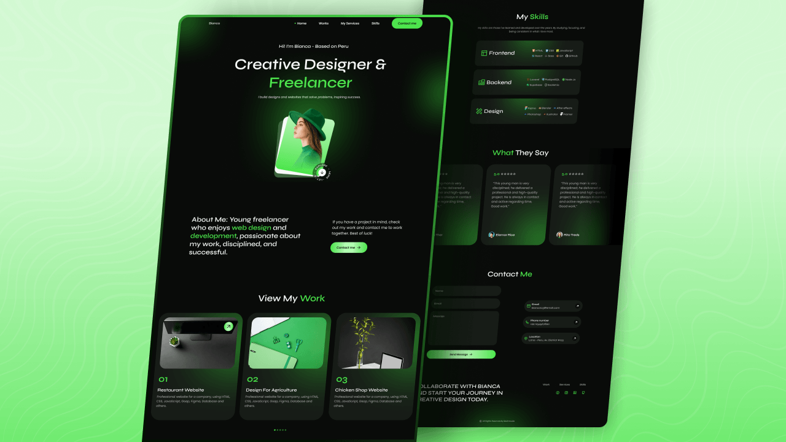

# Responsive Portfolio Website – Chanakya Deka

A modern, responsive personal portfolio website customized and developed by **Chanakya Deka**, built using HTML, CSS and JavaScript.

The website showcases my personal profile, technical skills, projects and contact information.

## Live Demo

[Visit My Portfolio](https://protfoliochanakya.vercel.app)

## Preview



## Features

- Fully responsive design for desktop, tablet and mobile devices.
- Clean and semantic HTML structure.
- Modern CSS styling and CSS variables.
- Interactive JavaScript functionality.
- Smooth scrolling between sections.
- Scroll animations.
- Compatible with modern browsers and devices.
- Personalized portfolio sections.

## Technologies Used

- HTML5
- CSS3
- JavaScript

## Installation

Clone this repository:

```bash
git clone https://github.com/chanakyadeka06-commits/Protfolio-chanakya.git
```

Navigate to the project directory:

```bash
cd Protfolio-chanakya
```

Open `index.html` in your browser or use the VS Code Live Server extension.

## Developer

**Chanakya Deka**

- GitHub: [@chanakyadeka06-commits](https://github.com/chanakyadeka06-commits)
- LinkedIn: [Chanakya Deka](https://www.linkedin.com/in/chanakyadeka)
- Portfolio: [protfoliochanakya.vercel.app](https://protfoliochanakya.vercel.app)

## Credits

Original portfolio design and tutorial inspiration: [Bedimcode](https://www.youtube.com/@Bedimcode).

This repository contains my customized version of the original project. Original source attribution is retained.v